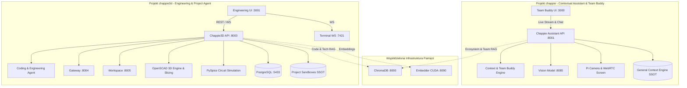

# Requirements

### Overview & Goals
Głównym celem jest ostateczne sfinalizowanie i naprawa architektonicznego podziału (decoupling) na dwa wyspecjalizowane, współpracujące systemy o precyzyjnie zdefiniowanych rolach produktowych:

1. **`chappie3d` (`C:\development\chappie3d`) — Autonomiczny Agent Inżynieryjny i Zarządca Projektów (Autonomous Engineering & Project Delivery Agent):**
   - Główny silnik do kompleksowego rozwiązywania, planowania i prowadzenia projektów programistycznych i inżynieryjnych.
   - Wbudowane moduły modelowania parametrycznego 3D (OpenSCAD, przygotowanie pod druk 3D) oraz symulacji technicznych (układy elektroniczne PySpice, symulacja ścieżek i obwodów).
   - Obsługa piaskownic projektowych, syntezy kodu, bezpiecznego terminala WebSocket (`/ws/terminal`), bazy relacyjnej (PostgreSQL) oraz bazy wiedzy RAG.
   - Architektura modularna — przygotowana na przyszłą obsługę wielu agentów (multi-agent) w środowisku produkcyjnym, ale zoptymalizowana pod natychmiastowe, stabilne testowanie pojedynczej funkcjonalności bez przedwczesnego overengineeringu.

2. **`chappie` (`C:\development\chappie`) — Kontekstowy Asystent Ekosystemu, Team Buddy & Scrum Master:**
   - Eksperymentalny system obserwacji i rozumienia otoczenia technologicznego, infrastruktury oraz dynamiki zespołu.
   - Nie jest to typowy agent do pisania kodu od zera, lecz inteligentny asystent kontekstowy łączący role Team Buddy, Architekta i Scrum Mastera.
   - Mechanizm **`General Context Engine`** gromadzący, syntetyzujący i kumulujący zależności technologiczne, wiedzę o istniejących modułach w repozytoriach oraz kompetencjach zespołu (np. szybka podpowiedź, jak zacząć zadanie, wykrycie że dany komponent już istnieje, lub rekomendacja kontaktu z właściwym inżynierem, np. "odezwij się do Tadka").
   - Interakcja multimodalna: czat na żywo (Live Video Chat), analiza obrazu z kamer (Raspberry Pi Camera) i przechwytywania ekranu (WebRTC Screen Capture), ekstrakcja ROI/OCR oraz ciągłe wzbogacanie kontekstu ogólnego.

3. **Zasoby współdzielone:**
   - Baza wektorowa ChromaDB (`chroma:8000`) oraz Embedder (`embedder:8090`) pozostają wspólną infrastrukturą wiedzy i pamięci semantycznej.

### Scope
#### In Scope
- **Naprawa i stabilizacja backendu `chappie3d`:**
  - Usunięcie wiszących tras `/api/live-chat/*`, `/api/pi/*`, `/api/vision/*` z `src/chappie/api.py` oraz wyeliminowanie błędów `NameError` (np. brakujący `PiSnapshotResponse`).
  - Uporządkowanie architektury wokół zarządzania projektami (`ProjectService`), syntezy kodu i generatora 3D/symulacji.
- **Uporządkowanie testów `chappie3d`:**
  - Dostosowanie `tests/unit/test_domain_services.py` do testowania wyłącznie usług inżynieryjnych (`ProjectService`, `GeneralChatService`).
  - Uproszczenie `tests/integration/services/ui/test_module6_logs_chat_vision.py` do diagnostyki logów (`TestModule6LogsAndDiagnostics`).
  - Zapewnienie brakującego katalogu `scripts/` (`update_workspace_permissions.py`, `generate_certs.py`) w `chappie3d`.
- **Infrastruktura i środowisko `chappie3d`:**
  - Dedykowany plik `compose.yaml` z bezkolizyjną pulą portów (UI: 3001, API: 8003, Gateway: 8004, Workspace: 8005, DB: 5433, Redis: 6380, Terminal WS: 7421).
  - Konfiguracja `.env`, `.gitignore` oraz katalogów danych (`data/`, `volumes/`, `logs/`).
- **Interfejs inżynierski `chappie3d/ui`:**
  - Kompletna stacja inżynierska (Czat Projektowy, Projekty/Piaskownice, Podgląd 3D CAD/OpenSCAD, Terminal Web, Baza Wiedzy, Konsola SQL, Logi).
  - 100% czysta kompilacja TypeScript bez błędów nieużywanych zmiennych (`noUnusedLocals: true`, `TS6133`).
- **Uporządkowanie repozytorium `chappie` (Team Buddy & General Context):**
  - Wyczyszczenie monolitu ze zbędnych modułów CAD 3D, symulacji PySpice i konsoli bazodanowej.
  - Skupienie backendu i frontendu `chappie` wokół interfejsu Live Video/Vision, ciągłego gromadzenia wiedzy o infrastrukturze i repozytoriach w `General Context` oraz asysty projektowej/zespołowej.

#### Out of Scope
- Wdrażanie pełnej orkiestracji klastra multi-agent na środowisku produkcyjnym (kod ma zachować modularność, ale implementacja skupia się na stabilnej weryfikacji funkcjonalności).
- Zmiana protokołu komunikacji zewnętrznego klienta CLI `terminal` (`C:\development\terminal`).
- Zmiana wag modeli VLM i LLM.
- Zastąpienie silnika wektorowego ChromaDB innym rozwiązaniem.

### User Stories
- **Jako inżynier / programista**, chcę uruchomić `chappie3d` na porcie 3001/8003, aby tworzyć projekty, generować parametryczne modele 3D do druku i uruchamiać symulacje bez zakłóceń ze strony strumieni wideo.
- **Jako członek zespołu inżynieryjnego**, chcę korzystać z `chappie` jako "Team Buddy / Scrum Mastera", który poprzez kamerę, ekran i czat analizuje bieżący problem techniczny, sprawdza w `General Context` powiązania infrastrukturalne, sugeruje istniejące moduły lub podpowiada kontakt z odpowiednią osobą w zespole.
- **Jako administrator systemu**, chcę uruchamiać oba środowiska jednocześnie bez konfliktów portów sieciowych, współdzieląc instancję bazy wektorowej ChromaDB.

### Functional Requirements
- **FR-1 (Stabilny start Chappie3D API):** Backend `chappie3d` startuje bez błędów importów, wystawiając endpointy `/api/projects/*`, `/api/tasks`, `/api/profiles/*`, `/ws/terminal`, `/api/logs`, `/api/health`.
- **FR-2 (Spójny zestaw testów Chappie3D):** 100% testów jednostkowych i integracyjnych w `chappie3d` wykonuje się pomyślnie.
- **FR-3 (Dedykowany UI Chappie3D):** Interfejs frontendowy `chappie3d/ui` udostępnia pełny panel inżynierski i kompiluje się bez naruszeń reguły `TS6133`.
- **FR-4 (General Context i Asystent Chappie):** Backend `chappie` gromadzi zdarzenia i wiedzę o infrastrukturze/zespole w `General Context`, obsługując zapytania kontekstowe, podgląd kamer Pi i ekstrakcję ROI/OCR.
- **FR-5 (Izolacja portów i środowisk):** `chappie` (UI: 3000, API: 8001) oraz `chappie3d` (UI: 3001, API: 8003) pracują niezależnie w środowiskach Docker Compose.

### Non-Functional Requirements
- **NFR-1 (Frontend Build Gate):** 100% zgodności z `vue-tsc -b && vite build` (zero martwego kodu, brak `TS6133`).
- **NFR-2 (Modularność kodu pod Multi-Agent):** Warstwy serwisów w `chappie3d` są odizolowane, umożliwiając w przyszłości podpięcie wielu agentów bez przebudowy domeny.
- **NFR-3 (Wydajność i separacja pamięci):** Wyeliminowanie niepotrzebnych zależności i narzutu pamięciowego w obu repozytoriach.

# Technical Design

### Current Implementation
Dotychczasowy stan repozytoriów po wstępnym rozdzieleniu:
- **`chappie3d` (`C:\development\chappie3d`):** repozytorium zawiera kompletny silnik agenta inżynieryjnego, generator OpenSCAD 3D, symulator obwodów i zarządzanie projektami. Jednakże w `src/chappie/api.py` pozostały nieusunięte trasy `/api/pi/*`, `/api/vision/*` oraz `/api/live-chat/*` bez odpowiednich importów, co powoduje `NameError: PiSnapshotResponse is not defined` przy imporcie i uniemożliwia uruchomienie aplikacji oraz zestawu testów `pytest`. Dodatkowo brakuje katalogu `scripts/` wymaganego przez testy uprawnień workspace, brakuje konfiguracji `compose.yaml` oraz dedykowanego frontendu `ui/`.
- **`chappie` (`C:\development\chappie`):** repozytorium zawiera wciąż nieoczyszczone moduły mechatroniczne i projektowe, zacierając jego rolę jako asystenta kontekstowego i Team Buddy.

### Key Decisions
1. **Wyrazisty podział ról systemowych (Architecture of Two Specialized Systems):**
   - **`chappie3d` (Autonomous Engineering & Project Delivery Agent):** przejmuje pełną odpowiedzialność za rozwiązywanie zadań inżynieryjnych, generowanie parametrycznych modeli 3D pod druk, symulację układów/ścieżek, edycję kodu w piaskownicach projektowych i interakcję w terminalu. Architektura serwisów zachowuje modularność umożliwiającą w przyszłości podpięcie klastra multi-agent na produkcji, przy zachowaniu prostoty testowania w obecnej fazie.
   - **`chappie` (Contextual Assistant, Scrum Master & Team Buddy):** skupia się na zrozumieniu otoczenia technicznego, infrastruktury i dynamiki zespołu. Prowadzi multimodalny czat na żywo (Live Video/Screen/Kamera) i za pośrednictwem silnika `General Context Engine` kumuluje wiedzę o ekosystemie (podpowiada jak podejść do zadania, wskazuje istniejące już fragmenty kodu w repozytoriach lub właściwe osoby w zespole).
2. **Niezależna alokacja portów i sieci Docker Compose:**
   - `chappie`: UI `3000`, API `8001`, VLM `8085`.
   - `chappie3d`: UI `3001`, API `8003`, Auth Gateway `8004`, Workspace `8005`, DB `5433`, Redis `6380`, Terminal WS `7421`.
   - Współdzielone: ChromaDB `8000`, Embedder `8090`.
   - *Uzasadnienie:* Pełna bezkolizyjność przy równoległym uruchomieniu obu systemów na jednej maszynie.
3. **Restrykcyjny Frontend Build Gate (Zasada #1 z AGENTS.md):**
   - Utworzenie `chappie3d/ui` z pełnym zestawem zakładek inżynierskich i odchudzenie `chappie/ui` do widoku Team Buddy / Live Video z rygorystyczną walidacją `vue-tsc -b` (zero martwego kodu, brak `TS6133`).

### Architecture Diagram

### Proposed Changes
#### Projekt `chappie3d` (`C:\development\chappie3d`):
- `src/chappie/api.py`: usunięcie wszystkich tras wideo (`/api/pi/*`, `/api/vision/*`, `/api/live-chat/*`) i powiązanych referencji, pozostawiając czyste endpointy inżynierskie (`/api/projects/*`, `/api/tasks`, `/api/profiles/*`, `/ws/terminal`, `/api/logs`, `/api/health`).
- `tests/unit/test_domain_services.py`: usunięcie `TestLiveChatService`, zachowanie i weryfikacja `TestGeneralChatService` oraz `TestProjectService`.
- `tests/integration/services/ui/test_module6_logs_chat_vision.py`: refaktoryzacja do `TestModule6LogsAndDiagnostics` testującego wyłącznie agregację i filtrowanie logów.
- `scripts/`: przeniesienie `scripts/update_workspace_permissions.py` oraz `scripts/generate_certs.py` dla sprawnego działania testów uprawnień workspace.
- `compose.yaml`: utworzenie kompletnej konfiguracji kontenerowej z dedykowaną pulą portów `chappie3d`.
- `ui/`: utworzenie panelu stacji inżynierskiej (Czat, Projekty, 3D CAD/Druk, Terminal, Baza Wiedzy, Konsola SQL, Logi) z zachowaniem 100% czystej kompilacji TypeScript (`vue-tsc -b`).

#### Projekt `chappie` (`C:\development\chappie`):
- `src/chappie/api.py` i serwisy: oczyszczenie z modułów inżynierskich 3D CAD, symulacji PySpice i konsoli SQL; skupienie logiki wokół `General Context Engine`, Live Chat, analizy wizyjnej i doradztwa projektowo-zespołowego.
- `ui/src/App.vue`: oczyszczenie interfejsu ze zbędnych zakładek inżynierskich, zoptymalizowanie widoku asystenta kontekstowego i kamer.

### Risks & Mitigations
- **Ryzyko:** Błędy kompilacji TypeScript (`TS6133`) przy usuwaniu nieużywanych deklaracji w `ui/`.
  - *Mitygacja:* Wykonywanie lokalnego `vue-tsc -b` po każdej zmianie w `ui/src/`.
- **Ryzyko:** Konflikty portów przy równoległym uruchomieniu obu systemów.
  - *Mitygacja:* Ścisła izolacja portów w plikach `compose.yaml` (3000/8001 dla chappie vs 3001/8003/8004/8005/5433/6380/7421 dla chappie3d).

# Testing

### Validation Approach
Weryfikacja zmian opiera się na automatycznych testach backendu (pytest) oraz bezwzględnej walidacji kompilacji statycznej frontendu (TypeScript strict build).

### Key Scenarios
1. **Weryfikacja API Chappie3D:**
   - Inicjalizacja aplikacji `create_app()` bez błędów importów.
   - Pomyślne zapytanie `GET /api/health` i `GET /api/logs/services`.
   - Zarządzanie projektami: `POST /api/projects/context`, transfer plików i generowanie parametrów OpenSCAD 3D.
   - Połączenie WebSocket na `/ws/terminal` i wykonanie bezpiecznego polecenia.
2. **Weryfikacja API Chappie:**
   - Pomyślny start aplikacji wideo i zapytania `/api/live-chat/contexts`, `/api/pi/status`.
   - Ekstrakcja OCR/ROI przez `/api/vision/extract`.
3. **Weryfikacja Frontend Build Gate:**
   - Uruchomienie `npm run build` (`vue-tsc -b && vite build`) w `chappie3d/ui` — 0 błędów, 0 nieużywanych zmiennych.
   - Uruchomienie `npm run build` w `chappie/ui` — 0 błędów, 0 nieużywanych zmiennych.

### Test Changes
- **`tests/unit/test_domain_services.py` (chappie3d):** usunięcie klasy `TestLiveChatService`.
- **`tests/integration/services/ui/test_module6_logs_chat_vision.py` (chappie3d):** usunięcie klas `TestModule6LiveChatContexts` i `TestModule6PiCameraAndVision`.
- **`tests/integration/test_workspace_service.py` (chappie3d):** zapewnienie dostępności `scripts.update_workspace_permissions`.

# Delivery Steps

### ✓ Step 1: Fix Chappie3D backend API, services, and test suites
`chappie3d` backend API starts without errors and all unit and integration tests pass cleanly.

- Remove obsolete `/api/pi/*`, `/api/vision/*`, `/api/live-chat/*` endpoints and leftover models/imports from `src/chappie/api.py`.
- Update `tests/unit/test_domain_services.py` to remove `LiveChatService` tests and retain `GeneralChatService` and `ProjectService` test suites.
- Refactor `tests/integration/services/ui/test_module6_logs_chat_vision.py` to focus strictly on logs and diagnostics in `chappie3d` (`TestModule6LogsAndDiagnostics`).
- Add missing `scripts/` directory (`scripts/update_workspace_permissions.py`, `scripts/generate_certs.py`) to `chappie3d` to resolve test imports.
- Execute full `pytest` suite in `chappie3d` and verify 100% pass rate.

### ✓ Step 2: Setup Chappie3D project configuration, Docker Compose, and environment
`chappie3d` has dedicated environment, Docker Compose with non-conflicting ports, and necessary runtime directories.

- Create `compose.yaml` in `chappie3d` with dedicated ports: UI (`3001`), API (`8003`), Gateway (`8004`), Workspace (`8005`), PostgreSQL (`5433`), Redis (`6380`), avoiding collisions with `chappie`.
- Set up `.env`, `.gitignore`, and initialize runtime storage folders (`data/`, `volumes/`, `logs/`).
- Verify database migrations and seed runners in `src/services/backend/alembic/` against the updated port configuration.

### ✓ Step 3: Establish Chappie3D Engineering UI with strict TypeScript validation
`chappie3d/ui` provides a full engineering workstation frontend that passes 100% clean TypeScript build without TS6133 errors.

- Initialize `chappie3d/ui` package and configuration (`package.json`, `tsconfig.json`, `vite.config.ts`, `Dockerfile`, `nginx.conf`).
- Configure `App.vue`, `api.ts`, and `types.ts` for engineering workstation tabs: Chat, Projects, 3D CAD/OpenSCAD, Terminal, Books/RAG, Database, and Logs, removing all unused video/camera code.
- Validate frontend build gate using `npm run build` (`vue-tsc -b && vite build`) ensuring zero dead code and no TS6133 violations.

### ! Step 4: Clean and align Chappie Contextual Assistant and Team Buddy repository
`chappie` repository is stripped of 3D/engineering bloat, operating purely as a lightweight Contextual Assistant, Team Buddy, and General Context intelligence platform.

- Clean `src/chappie/api.py` and service containers in `chappie` to expose Live Chat, Pi camera/screen vision, General Contexts knowledge engine, and service logs.
- Remove mechatronics (`electronics_standard.py`, `circuit_sim.py`), project management (`projects.py`), and terminal manager from `chappie`.
- Streamline `chappie/ui` to a dedicated single-view Team Buddy / Live Video Chat interface with camera stream and vision ROI inspection, verifying 100% clean TypeScript build (`vue-tsc -b`).
- Run test suites in `chappie` to ensure zero regressions across video and vision workflows.