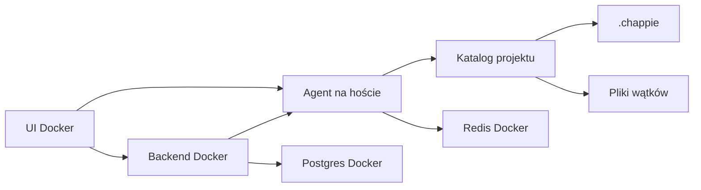

# Wymagania

### Cel
Agent działa na hoście Windows i ma dostęp tylko do jawnie otwartych projektów; nie tworzy osobnych „wolumenów projektowych”. Dla każdego projektu trwały wspólny kontekst to `.chappie`, historie wielu wątków są osobnymi plikami w projekcie, a Redis służy wyłącznie jako cache.

### Zakres i kryteria
- Otwieranie projektu wskazuje rzeczywisty katalog na dysku; import/utworzenie projektu zapisuje zwykły katalog pod konfigurowalną ścieżką hosta. Zapis plików przez agenta pozostaje ograniczony do katalogu wybranego projektu.
- Każdy wątek ma stabilny `session_id`, niezależną historię i możliwość ponownego otwarcia po restarcie; `.chappie` przechowuje tylko wspólną pamięć projektu, nie pełne transkrypty. Cache Redis nigdy nie jest jedynym źródłem historii.
- Usunięcie wątku nie usuwa innych wątków ani `.chappie`. Niedostępny Redis nie blokuje pracy; błąd zapisu trwałego musi być sygnalizowany, nie maskowany.
- W `compose.yaml` nie pozostają nazwane wolumeny Docker. Postgres, Redis i pozostałe usługi kontenerowe zachowują dane na zwykłych katalogach hosta (bind mounts); agent jest uruchamiany osobno na hoście.
- Migracja istniejących projektów, historii i danych usług nie usuwa automatycznie starych danych. Zachować obsługę istniejących klientów `/api` i `/ws/terminal` albo przewidzieć ich dostosowanie bez zmiany formatu wiadomości.

# Projekt techniczny

### Stan obecny i decyzje
`compose.yaml` uruchamia agenta w kontenerze, trzyma projekty w `./volumes`, Postgresa/Redisa w nazwanych wolumenach i kieruje backend do `http://agent:8001`; `ui/nginx.conf` kieruje `/ws/terminal` do tego samego hosta. `src/chappie/projects.py` potrafi otwierać lokalny katalog i synchronizować `.chappie`, lecz importuje do `volumes/` i przechowuje jedną `session_history` w `data/projects.json`. `src/chappie/agent.py:get_session_turns/get_session_messages` pobiera historię projektu bez filtrowania po sesji; `src/chappie/volume_manager.py` implementuje sandbox oraz zapis awaryjny sesji. Zachowujemy istniejące sprawdzanie granic ścieżki, ale oddzielamy je od modelu przechowywania w wolumenach.

### Kontrakty i przepływ
- `ProjectStorage` udostępni operacje `list_threads(project_id)`, `get_thread_turns(project_id, session_id)`, `append_thread_turn(project_id, session_id, turn)` i `delete_thread(project_id, session_id)`; identyfikatory są walidowane, a trwałe pliki np. `<root>/.chappie-threads/<session_id>.json` zapisywane atomowo pod blokadą per wątek. `.chappie` pozostaje wspólnym kontekstem aktualizowanym po udanym zapisie tury, bez kopiowania całej transkrypcji.
- `ProjectContext.active_session_id` może służyć wyłącznie do wskazania wątku domyślnego; wycofać projektowe `session_history` jako źródło bieżącej historii, migrując dotychczasowe wpisy do pliku odpowiadającego staremu `active_session_id`. Wyraźnie rozdzielić brak sesji od wyboru domyślnej przy kompatybilnych wywołaniach API.
- `CodingAgent` zawsze pobiera historię według pary `(project_id, session_id)`, nie nadpisuje historii innych wątków; cache `RedisCacheManager` używa odrębnych kluczy `chappie:thread:<project_id>:<session_id>`, TTL i unieważnienia przy modyfikacjach. Istniejące czyszczenie nieaktywnych kontekstów projektu nie może usuwać cache wątków.
- `src/chappie/api.py`, `src/chappie/services/project_service.py`, `ui/src/api.ts`, `ui/src/types.ts`, `ui/src/App.vue` i odpowiednie widoki: lista/tworzenie/przełączanie/usuwanie wątków oraz operacje projektu oparte o ścieżki hosta; zachować istniejące wywołania z `session_id`.
- Przenieść dane pomocnicze (profile, rejestr projektów, sesje bez projektu, konteksty ogólne, logi) do konfigurowalnego katalogu danych hosta; w `src/chappie/config.py` i uruchamianiu agenta ustawić adresy usług kontenerowych na opublikowane porty `localhost` (w tym model/Chroma/embedder, jeśli działają w Dockerze). W `compose.yaml` usunąć usługę `agent`, zmienić adresy backendu/UI na host (`host.docker.internal`) i podpiąć jawne katalogi hosta dla usług zachowanych w Compose; `ui/nginx.conf` zachowa proxy WebSocket. Backend i terminal nadal rozmawiają z agentem przez HTTP/WebSocket.
- Migracja: najpierw kopia danych i eksport nazwanych wolumenów Postgresa/Redisa, potem idempotentne przeniesienie projektów i historii; odbudowa cache Redis z plików, z weryfikacją liczby projektów/wątków przed odłączeniem starych ścieżek. Redis bez trwałych danych biznesowych może zostać odbudowany, ale eksport i zachowanie danych przed zmianą pozostają bezpieczną procedurą.

### Architektura

### Ryzyka
Nazwane wolumeny Postgresa nie mogą być po prostu usunięte bez eksportu danych. Hostowy agent nie rozwiąże nazw usług Docker (`redis`, `chroma`, `model`), dlatego plan wymaga jawnego mapowania adresów i testu połączeń; uprawnienia do ścieżek hosta, symlinki oraz równoległy zapis są granicami bezpieczeństwa. Stare endpointy „volumes” i zależności w kliencie terminalowym wymagają audytu przed wyłączeniem, aby nie zepsuć istniejącego kontraktu.

# Weryfikacja

### Kontrole
- Testy jednostkowe `tests/unit/test_projects.py` i integracyjne `tests/integration/test_host_project_access.py`, `tests/integration/test_directory_projects.py`, `tests/integration/test_agent_project.py`: izolacja dwóch wątków, zapis/odczyt po restarcie, migracja historii, brak dostępu poza projektem i bezpieczna obsługa `session_id`/symlinków.
- Testy Redis: odczyt z dysku po wyłączeniu cache, unieważnienie po zmianie pliku, brak kolizji z czyszczeniem cache projektów.
- Weryfikacja konfiguracji Compose, połączeń backend↔agent oraz proxy `/ws/terminal`; testy integracyjne endpointu terminala i, jeśli dostępne, niezależnego klienta terminalowego. Uruchomienie `npm run build` w `ui/` po każdej edycji UI bez wyłączania `strict`/`noUnusedLocals`.
- Próbna migracja na kopii danych; porównanie liczby i treści projektów/wątków oraz danych Postgresa przed usunięciem zależności od poprzednich lokalizacji.

# Delivery Steps

### ✓ Step 1: Przenieść usługi i agenta na układ hostowy
Agent działa na hoście, a kontenery używają zwykłych katalogów hosta zamiast nazwanych wolumenów.
- Zmienić `compose.yaml`, `ui/nginx.conf`, ustawienia hostowe w `src/chappie/config.py` i instrukcję uruchamiania; skonfigurować adresy dla backendu, Redis, Chroma, modelu, embeddera i WebSocket.
- Dodać bezpieczną procedurę eksportu i migracji danych Postgresa oraz weryfikację poprawności po przeniesieniu.
- Sprawdzić konfigurację Compose i połączenia API bez usuwania starych danych.

### ✓ Step 2: Oprzeć projekty na katalogach dyskowych
Otwieranie, tworzenie i import projektów nie wymaga `volumes/projects`.
- Zmienić `ProjectStorage` w `src/chappie/projects.py`, `ProjectService` i konfigurację `src/chappie/config.py`, zachowując istniejący sandbox z `VolumeManager` po dostosowaniu jego odpowiedzialności.
- Przenieść pozaprojektowe dane agenta do konfigurowalnego katalogu hosta; zaplanować idempotentną migrację istniejących projektów i `.chappie`.
- Rozszerzyć testy dostępu do katalogów i sprawdzić, czy agent nie zapisuje poza wybranym projektem.

### ✓ Step 3: Dodać trwałe, niezależne historie wątków
Każdy wątek projektu ma własny plik historii, a `.chappie` pozostaje wspólną pamięcią projektu.
- Dodać operacje wątków i bezpieczne, atomowe zapisy w `src/chappie/projects.py`; zmigrować dotychczasową `session_history` z `data/projects.json`.
- Zmienić `src/chappie/agent.py` tak, by odczyt i zapis używał `(project_id, session_id)`; dodać cache wątków w `src/chappie/redis_cache.py` bez zależności od trwałości Redis.
- Dodać testy izolacji, restartu, migracji, awarii Redis i równoległych zapisów.

### ✓ Step 4: Udostępnić zarządzanie wątkami w API i UI
Użytkownik może tworzyć, wybierać i usuwać wątki wewnątrz jednego projektu bez utraty wspólnego `.chappie`.
- Dodać kompatybilne operacje w `src/chappie/api.py` i `src/chappie/services/project_service.py`, zachowując kontrakt terminalowy.
- Zaktualizować `ui/src/api.ts`, `ui/src/types.ts` i odpowiednie widoki w `ui/src/App.vue`; usunąć nieużywany kod.
- Rozszerzyć testy API/terminala i zweryfikować czysty `npm run build` UI.