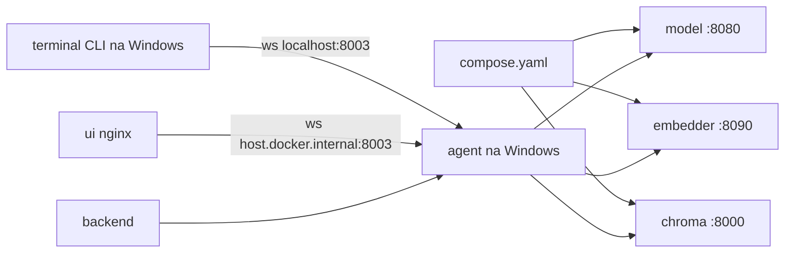

# Wymagania

### Cel i zakres
Dokończyć konfigurację inferencji w **jednym** `compose.yaml`: zachować istniejący `model`, dołączyć `embedder` i `chroma`, oraz umożliwić działanie **osobnego klienta z `C:\development\terminal` na Windows** z agentem `Chappie3D`. Agent pozostaje na hoście; `db`, `redis`, `workspace`, `backend` i `ui` zachowują porty, wolumeny i zależności. Nie dodawać kontenera CLI, nie zmieniać protokołu `/ws/terminal` ani kodu UI; połączenia zdalne wymagają TLS. Nie używać płatnego zewnętrznego API; lokalna praca nadal generuje koszty sprzętu, energii i danych.

### Kryteria akceptacji
- Operator może uruchomić nowe usługi z głównego pliku Compose bez przypadkowego startu inferencji podczas zwykłego uruchamiania dotychczasowego stosu.
- Agent hostowy nadal trafia do modelu pod `http://localhost:8080/v1`, embeddera pod `http://localhost:8090` i Chroma na `localhost:8000` (lub jawnie skonfigurowane odpowiedniki).
- Model i embedder zachowują interfejsy z `C:\development\chappie`: OpenAI-compatible `/v1` dla modelu oraz `GET /health` i `POST /v1/embeddings` dla embeddera; konfiguracja uruchamia się bez odwołań do kodu poza kontekstem budowania tego repozytorium.
- Trwałe dane Chroma i pliki modelu nie są usuwane ani zastępowane przy wdrożeniu; nie stosować `docker compose down -v`.
- Zainstalowany klient terminalowy z `C:\development\terminal` w katalogu projektu zawierającym `.chappie` i `.venv` łączy się lokalnie przez `ws://localhost:8003/ws/terminal` (alternatywnie przez UI na `3001`), wymienia handshake, zapytanie, tokeny i odpowiedź oraz może bezpiecznie zapisać zwrócone pliki w katalogu projektu. Stary port `7420` i domyślne `wss` nie są używane dla lokalnego połączenia bez TLS; wcześniej zapisane ustawienia `~/.chappie/config.json` trzeba jawnie uwzględnić.

# Projekt techniczny

### Stan obecny
`compose.yaml` ma sześć usług i sieć `backend`; `model` już jest zdefiniowany jako opt-in w profilu `inference` (GPU, `docker/model.Dockerfile`, port 8080, GGUF jako bind mount read-only, `/health`), a backend kieruje do agenta przez `host.docker.internal:8003`. `README.md` (linie 3, 22–26) podaje hostowe adresy 8080/8090/8000 i `ws://localhost:8003/ws/terminal` lub trasę przez `3001`; wymaga aktualizacji nieprawdziwego stwierdzenia, że model nie jest w Compose. `ui/nginx.conf` (linie 13–19) przekazuje WebSocket do agenta; `tests/unit/test_host_deployment_contract.py` pilnuje braku kontenera `agent`, bind mountów i adresów hostowych. Referencyjny `C:\development\chappie\compose.yaml` ma wzorce dla `chroma` (`chromadb/chroma:1.5.9`) i `embedder` (GPU, `docker/embedder.Dockerfile`); `src/chappie/embedder_api.py` definiuje API embeddera. W docelowym `Chappie3D` **nie ma `src/`**, więc nie można zbudować `workspace` i `backend` ani uruchomić hostowego agenta; test kontraktu importuje nieobecne moduły. Osobny `C:\development\terminal\chappie_cli\config.py` domyślnie ustawia `wss://0.0.0.0:7420`, `main.py` przyjmuje `--host`, `--port`, `--no-ssl`, a `client.py` realizuje handshake, query i bezpieczny zapis plików przez `validate_safe_path`; `env_detector.py` wymaga `.chappie` i środowiska projektu.

### Decyzje i zmiany
- Zachować istniejący `model` i dodać **tylko** `embedder` oraz `chroma` do `compose.yaml` z profilem `inference`, siecią `backend` i portami hostowymi zgodnymi z `README.md`. Nie dodawać zależności backendu od inferencji: agent jest poza Compose.
- Nie odtwarzać modelu ponownie: istniejący `docker/model.Dockerfile` używa `ghcr.io/ggml-org/llama.cpp:server-cuda-b9544`, a `compose.yaml` montuje GGUF z `MODEL_GGUF_PATH` read-only. Sprawdzić dostępność pliku, GPU NVIDIA, flag serwera, portu 8080 i `/health`; nie deklarować działania bez GPU.
- Dla `embedder` użyć wzorca `C:\development\chappie\docker\embedder.Dockerfile` (Qwen3-Embedding-0.6B, przypięta rewizja) i przenieść do docelowego repo minimalny kod API oraz niezbędne modele Pydantic z `src/chappie/embedder_api.py` i `src/chappie/models.py` (lub pełne zgodne źródła, jeśli są odtwarzane), tak by `docker build` używał wyłącznie zawartości `Chappie3D`; nie budować z zewnętrznego katalogu. Zachować ścieżki `/health` i `/v1/embeddings` oraz schemat `EmbeddingRequest`/`EmbeddingResponse`.
- Dla `chroma` użyć referencyjnego `chromadb/chroma:1.5.9` i trwałego bind mountu na dedykowany katalog hosta; przed przełączeniem zbadać położenie wcześniejszych danych, nie tworzyć pustej kolekcji zamiast istniejącej. Nie nadpisywać danych `db` i `redis`.
- W `C:\development\terminal\chappie_cli\config.py` zmienić domyślne wartości **tylko dla nowej konfiguracji** na `server_host=localhost`, `server_port=8003`, `use_ssl=False` oraz `api_port=8004` (gdy używany z backendem hostowym przez Compose); zachować możliwość jawnego `wss`, certyfikatów i portów niestandardowych. W `main.py` uaktualnić pomoc flag, nie zmieniać protokołu ani zabezpieczenia ścieżek w `client.py`. Plik `~/.chappie/config.json` ma pierwszeństwo, więc dokumentacja musi pokazać korektę już zapisanej konfiguracji lub uruchomienie z `--host localhost --port 8003 --no-ssl`.
- Zweryfikować zgodność `C:\development\chappie` z brakującymi źródłami `src/services/backend`, `src/services/workspace` i agenta `services.agent.main:app`; odtworzyć tylko niezbędny kod z zależnościami, nie kopiować całego `src/` bez audytu. W `README.md` poprawić stan obecny modelu i opisać start profilu inferencji oraz hostowego klienta. Rozszerzyć `tests/unit/test_host_deployment_contract.py` o usługi, porty, profil i bind mounty; w obu repozytoriach sprawdzić testy integracji terminala bez zmiany WebSocket.

### Przepływ

### Ograniczenia
Referencyjny `C:\development\chappie` istnieje, lecz nie należy bez audytu przenosić jego całego `src/`: bazowe obrazy i hostowy agent docelowego projektu nadal potrzebują zgodnych źródeł. Przed testem rzeczywistego terminala ustalić zgodność wersji i odtworzyć wyłącznie wymagane pliki z właściwego źródła; jeśli brak zgodnego kodu, wprost zgłosić blokadę, zamiast deklarować działającą aplikację. Zmiana domyślnego TLS na `ws` jest wyłącznie dla lokalnego hosta; dla zdalnego dostępu wymagane jest bezpieczne zakończenie TLS i jawna konfiguracja klienta. Referencyjny model i embedder żądają GPU NVIDII; sprawdzić dostępność GPU, RAM/VRAM, uprawnienia do artefaktów oraz konflikty portów `8000/8080/8090/8003` przed startem. Nie obiecywać funkcjonalnego uruchomienia na CPU bez osobnej walidacji.

# Weryfikacja

### Scenariusze
- `docker compose config --quiet` oraz wynik profili: bez profilu brak usług inferencji przy zwykłym starcie; z profilem istniejący model oraz nowe embedder i Chroma mają oczekiwane porty i katalogi.
- Po udostępnieniu lokalnie zgodnych źródeł i pliku GGUF: build/start stosu, gotowość kontenerów, żądanie modelu przez `/v1`, `POST /v1/embeddings` ze schematem z kodu referencyjnego, zapis i odczyt danych Chroma po restarcie.
- Regresja hostowego agenta, routingu WebSocket i istniejących asercji `tests/unit/test_host_deployment_contract.py`; testy `tests/integration/test_terminal_endpoint_integration.py` po stronie serwera i `C:\development\terminal\tests\integration\test_terminal_client_integration.py` po stronie klienta; test ustawień domyślnych i zapisanej konfiguracji z TLS bez naruszenia protokołu.
- Po przywróceniu zgodnych źródeł: uruchomić agenta, użyć klienta z katalogu projektu z `.chappie` i `.venv`, sprawdzić handshake, strumień tokenów, odpowiedź oraz bezpieczny zapis pliku i odrzucenie wyjścia poza katalog projektu; powtórzyć przez `localhost:3001` w razie korzystania z UI. Jeżeli źródła pozostaną nieobecne, odnotować testy niemożliwe do uruchomienia, nie podawać fałszywego sukcesu.

# Delivery Steps

### ✓ Step 1: Dołączyć embedder i trwałą Chroma
Profil `inference` udostępnia hostowemu agentowi komplet trzech zgodnych usług bez naruszania danych bazowego stosu.
- Przenieść do `Chappie3D` niezbędne pliki źródłowe API embeddera i Dockerfile z referencyjnego `C:\development\chappie`, po sprawdzeniu zależności `EmbeddingRequest` i `EmbeddingResponse`; build nie może zależeć od plików poza docelowym repozytorium.
- Dodać `embedder` i `chroma` do `compose.yaml` według referencji, z profilem `inference`, portami `8090` i `8000`, sondami gotowości oraz trwałym katalogiem Chroma jako bind mountem; zachować istniejący model na 8080.
- Potwierdzić istniejący GGUF, zasoby GPU i położenie wcześniejszych danych Chroma przed przełączeniem, bez nadpisywania ich pustym katalogiem.
- Rozszerzyć `tests/unit/test_host_deployment_contract.py` o konfigurację trzech usług i brak regresji istniejącego kontraktu; zweryfikować `docker compose config --quiet`.

### * Step 2: Przywrócić zgodne źródła serwera i hostowego agenta
Istniejące usługi bazowe i endpoint `/ws/terminal` dają się uruchomić z kodu w `Chappie3D`.
- Porównać wymagane moduły i Dockerfile `src/services/backend`, `src/services/workspace` oraz `services.agent.main:app` z `C:\development\chappie`; odtworzyć jedynie zgodny kod i zależności, bez hurtowego nadpisywania `src/`.
- Zweryfikować budowę obrazów `backend` i `workspace`, start agenta na porcie 8003 i istniejące testy kontraktu; przy niezgodności źródeł jawnie zgłosić blokadę wdrożenia.

###   Step 3: Zintegrować hostową aplikację terminalową z agentem
Klient z osobnego repozytorium łączy się domyślnie z lokalnym agentem bez TLS, zachowując konfigurację bezpiecznych połączeń zdalnych.
- W `C:\development\terminal\chappie_cli\config.py` dopasować nowe domyślne ustawienia do `localhost:8003` i `ws`, a opcjonalny port API do `8004`; zachować istniejące nadpisania z pliku i flag CLI.
- W `C:\development\terminal\chappie_cli\main.py` poprawić opisy flag portu i hosta, a w `C:\development\terminal\README.md` przykład lokalnego uruchomienia, z jawnym rozróżnieniem zdalnego `wss`; nie zmieniać `chappie_cli/client.py` ani schematu handshake i zapisów sandboxowych.
- Rozszerzyć testy konfiguracji klienta i oba testy integracyjne terminala (`C:\development\terminal\tests\integration\test_terminal_client_integration.py`, `tests/integration/test_terminal_endpoint_integration.py`) o zgodność adresów, handshake/query/response oraz obsługę błędu i rozłączenia.

###   Step 4: Udokumentować i sprawdzić start pełnego stosu z terminalem
`README.md` zawiera odtwarzalną ścieżkę uruchomienia usług, hostowego agenta i aplikacji terminalowej bez naruszenia istniejących danych.
- W `README.md` opisać profil inferencji, katalog modelu i danych, adresy agenta, przygotowanie projektu `.chappie`/`.venv`, polecenie instalacji/uruchomienia klienta z `C:\development\terminal` oraz korektę już zapisanej konfiguracji klienta.
- Zachować `ui/nginx.conf` oraz procedurę migracji `docs/host-migration.md`; potwierdzić brak regresji hostowych tras i testów kontraktu Compose.
- Po odtworzeniu zgodnych źródeł zbudować stos i sprawdzić gotowość usług oraz trwałość Chroma po restarcie; nigdy nie używać `docker compose down -v`.
- Uruchomić rzeczywistego klienta z hostowym agentem i sprawdzić handshake, query, tokeny, odpowiedź oraz zabezpieczenie ścieżek; przy brakujących źródłach zgłosić blokadę zamiast deklarować wdrożenie.