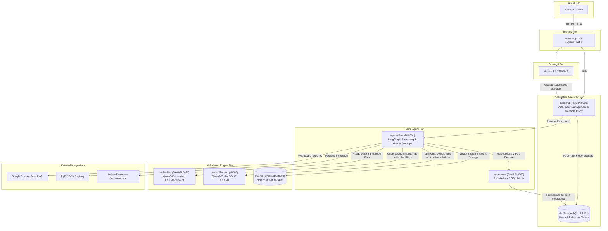
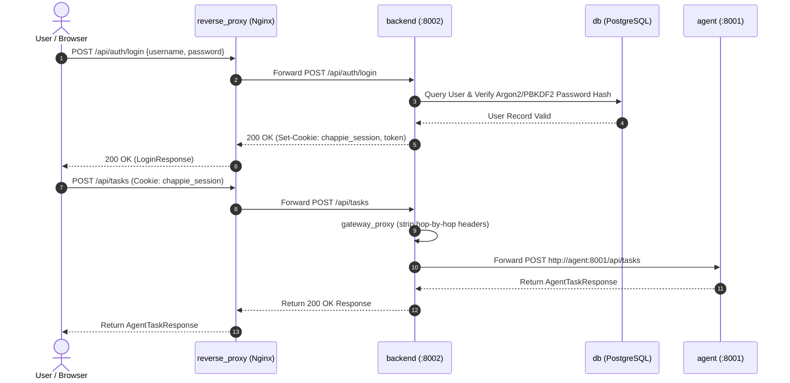
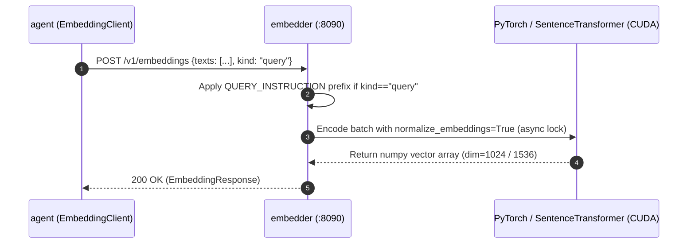
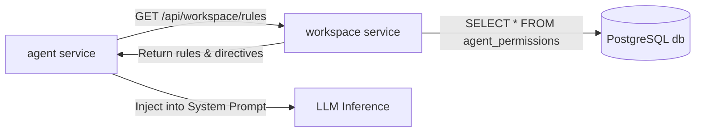
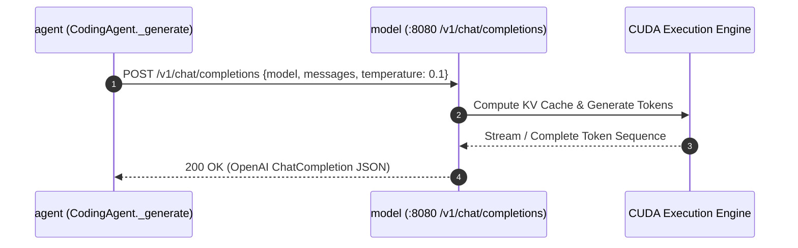
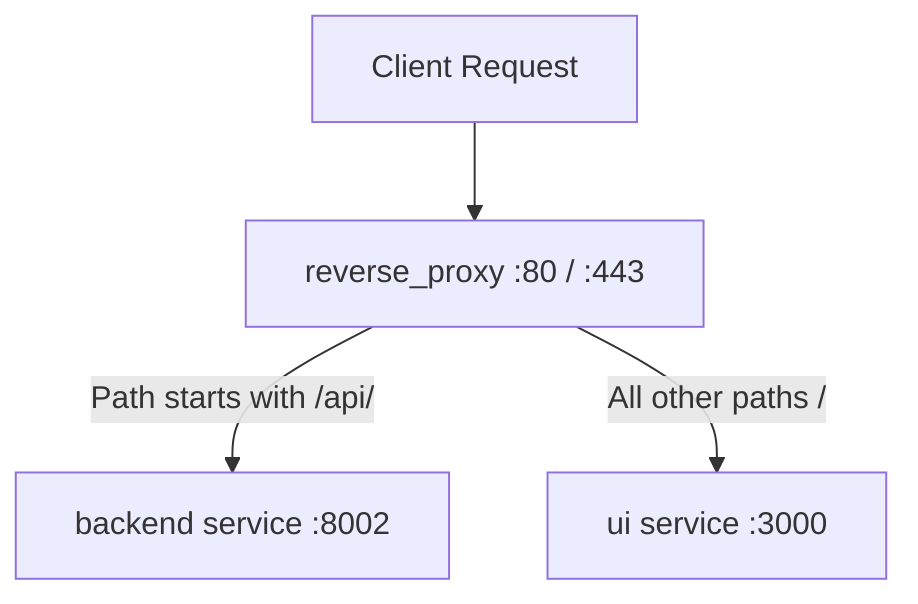
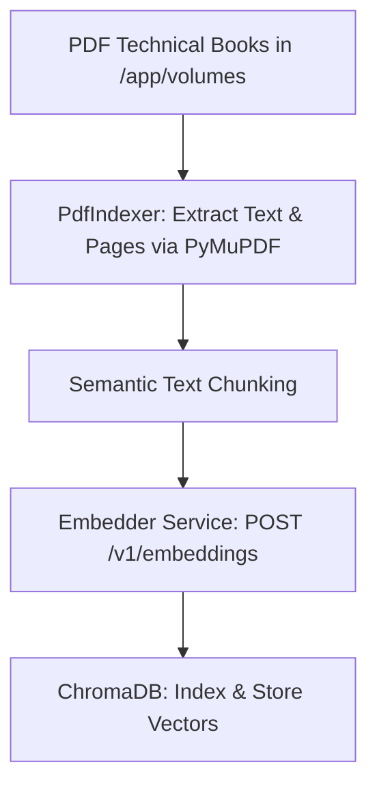
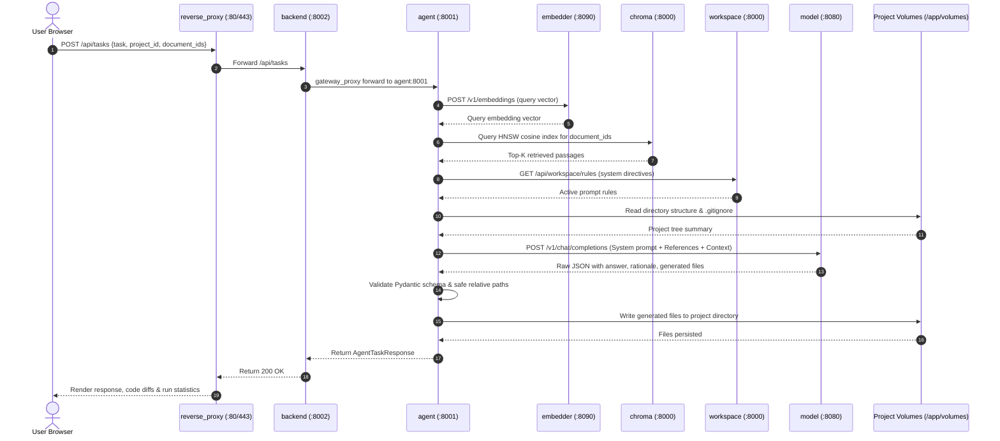

# Chappie Architecture & Microservices API Documentation

### System Architecture Overview

Chappie is composed of a decoupled, security-hardened microservices architecture running across isolated Docker network bridges (`frontend`, `backend`). The system orchestrates local LLM inference, dense vector embeddings, vector similarity search, relational user/workspace persistence, filesystem sandboxing, and web/PyPI tool integration.



---

### Microservices Summary Matrix

| Service Name | Internal URL / Port | Technology Stack | Network Tier | Primary Responsibility | Upstream Consumers | Downstream Dependencies |
| :--- | :--- | :--- | :--- | :--- | :--- | :--- |
| **reverse_proxy** | `http://reverse_proxy:80`, `:443` | Nginx 1.27 Alpine | `frontend` | TLS termination, path routing (`/` -> UI, `/api/` -> Backend) | Web Browsers, External Clients | `ui`, `backend` |
| **ui** | `http://ui:3000` | Vue 3, Vite, Tailwind CSS, Nginx | `frontend` | Single-page application frontend user interface | `reverse_proxy` | `backend` (`/api/*`) |
| **backend** | `http://backend:8002` | FastAPI, SQLAlchemy 2, Alembic, PostgreSQL | `frontend`, `backend` | Authentication, RBAC, session cookie management, API gateway proxy | `reverse_proxy`, `ui` | `db` (Postgres), `agent` |
| **agent** | `http://agent:8001` | FastAPI, LangGraph, Pydantic v2, Python 3.12 | `backend` | Orchestration, RAG, sandboxed volume operations, projects, profiling | `backend` (Gateway Proxy), `ui` | `embedder`, `chroma`, `model`, `workspace`, Local Volumes |
| **embedder** | `http://embedder:8090` | FastAPI, PyTorch, SentenceTransformers, CUDA | `backend` | Dense vector embedding generation for queries and literature chunks | `agent`, `indexer` | GPU Hardware / CUDA Runtime |
| **model** | `http://model:8080` | `llama.cpp` server (CUDA GGUF) | `backend` | OpenAI-compatible high-performance local LLM chat completion | `agent` | GPU Hardware / CUDA Runtime |
| **chroma** | `http://chroma:8000` | ChromaDB 1.5.9 | `backend` | Vector database with persistent HNSW index for PDF retrieval | `agent`, `indexer` | Persistent volume (`chroma_data`) |
| **workspace** | `http://workspace:8000` | FastAPI, SQLAlchemy 2, PostgreSQL | `backend` | Agent security policies, prompt directives, dynamic SQL administration | `agent` (`WorkspaceClient`), Admins | `db` (Postgres) |
| **db** | `postgresql://db:5432` | PostgreSQL 16 Alpine | `backend` | Relational persistence for user accounts and workspace rules | `backend`, `workspace` | Persistent volume (`postgres_data`) |
| **indexer** | CLI (`chappie-index`) | Python 3.12, PyMuPDF, Chappie Indexer Engine | `backend` | Batch PDF ingestion, chunking, and ChromaDB vector population | Background Jobs, System Admins | `chroma`, `embedder`, PDF Volumes |

---

### 1. Backend Gateway & Authentication Service (`backend`)

#### Overview
The `backend` service acts as the secure entry gateway and identity provider for the Chappie platform. It provides session-based authentication, user account management (CRUD), and an asynchronous reverse gateway proxy that forwards all non-auth API calls to the internal `agent` microservice.

- **Container Port:** `8002`
- **Internal URL:** `http://backend:8002`
- **Primary Consumers:** `reverse_proxy`, `ui` (Vue 3 Web App), External API clients.
- **Downstream Dependencies:** `db` (PostgreSQL 16), `agent` (`http://agent:8001`).



#### API Endpoints & Request / Response Specifications

##### 1.1 Health Check
- **Endpoint:** `GET /api/backend/health`
- **Description:** Verifies that the backend gateway is alive.
- **Consumed by:** Docker health check, monitoring systems.
- **Request:** None
- **Response:** `200 OK`
  ```json
  {
    "status": "ok",
    "service": "chappie-backend"
  }
  ```

##### 1.2 User Login
- **Endpoint:** `POST /api/auth/login`
- **Description:** Authenticates user credentials, generates a signed session token, and sets the `chappie_session` HTTP-only cookie.
- **Consumed by:** UI Login View (`src/views/LoginView.vue`).
- **Request (`LoginRequest`):**
  ```json
  {
    "username": "admin",
    "password": "chappie_secret_password"
  }
  ```
- **Response (`LoginResponse`):** `200 OK`
  ```json
  {
    "success": true,
    "token": "eyJhbGciOiJIUzI1NiIsInR5cCI6IkpXVCJ9...",
    "username": "admin",
    "is_admin": true,
    "expires_in_seconds": 10800
  }
  ```
- **Error Responses:** `401 Unauthorized` for invalid credentials.

##### 1.3 Active Session Verification
- **Endpoint:** `GET /api/auth/session`
- **Description:** Inspects the active cookie or Bearer header to verify authentication state and privileges.
- **Consumed by:** UI Auth Guards & Navigation Header.
- **Request:** Headers (`Authorization: Bearer <token>`) or Cookie (`chappie_session=<token>`).
- **Response (`SessionInfoResponse`):** `200 OK`
  ```json
  {
    "authenticated": true,
    "username": "admin",
    "is_admin": true,
    "expires_at": "2026-11-08T06:38:00Z"
  }
  ```
- **Error Responses:** `401 Unauthorized` if session is missing, tampered, or expired.

##### 1.4 Logout
- **Endpoint:** `POST /api/auth/logout`
- **Description:** Clears the session cookie on the client.
- **Consumed by:** UI Logout Button.
- **Request:** Empty
- **Response (`MessageResponse`):** `200 OK`
  ```json
  {
    "message": "Successfully logged out.",
    "success": true
  }
  ```

##### 1.5 List Users (Admin Only)
- **Endpoint:** `GET /api/users`
- **Description:** Lists all registered system users.
- **Consumed by:** UI User Management Dashboard.
- **Headers:** `Authorization: Bearer <admin_token>` or Admin Session Cookie.
- **Response:** `200 OK` (`list[UserResponse]`)
  ```json
  [
    {
      "id": 1,
      "username": "admin",
      "is_admin": true,
      "created_at": "2026-01-01T00:00:00Z",
      "updated_at": "2026-01-01T00:00:00Z"
    }
  ]
  ```

##### 1.6 Create User (Admin Only)
- **Endpoint:** `POST /api/users`
- **Description:** Creates a new user with a hashed password.
- **Consumed by:** UI User Management.
- **Request (`UserCreate`):**
  ```json
  {
    "username": "engineer1",
    "password": "SecurePassword123!",
    "is_admin": false
  }
  ```
- **Response (`UserResponse`):** `201 Created`
  ```json
  {
    "id": 2,
    "username": "engineer1",
    "is_admin": false,
    "created_at": "2026-11-08T03:30:00Z",
    "updated_at": "2026-11-08T03:30:00Z"
  }
  ```

##### 1.7 Update / Delete User (Admin Only)
- **Endpoints:** `PUT /api/users/{user_id}`, `DELETE /api/users/{user_id}`
- **Description:** Updates credentials/permissions or deletes a user account (prevents self-deletion).
- **Consumed by:** UI Admin Settings.

##### 1.8 Dynamic Gateway Proxy Route
- **Endpoint:** `ALL /api/{full_path:path}`
- **Description:** Intercepts any API request not matching auth/users routes, strips hop-by-hop headers, and transparently streams the request to `http://agent:8001/api/{full_path}`.
- **Consumed by:** UI frontend for all Agent, Project, RAG, Volume, and Log actions.
- **Downstream Call:** `httpx.AsyncClient.request(method, "http://agent:8001/api/...", ...)`

---

### 2. Core Agent & Orchestration Service (`agent`)

#### Overview
The `agent` service is the central reasoning and execution engine of Chappie. It hosts the LangGraph state machine (`CodingAgent`), semantic search integration with ChromaDB, filesystem sandbox manager (`VolumeManager`), project contexts (`ProjectStorage`), profiles, electronic circuit simulation verification (PySpice/NGSpice), and real-time tool engines (Web Search and PyPI).

- **Container Port:** `8001`
- **Internal URL:** `http://agent:8001`
- **Primary Consumers:** `backend` (via Gateway Proxy), UI, Test Suites.
- **Downstream Dependencies:** `embedder` (`http://embedder:8090`), `chroma` (`http://chroma:8000`), `model` (`http://model:8080`), `workspace` (`http://workspace:8000`), External APIs (Google Search, PyPI), Local Filesystem Volumes.

```mermaid
flowchart TD
  subgraph Agent Flow (/api/tasks)
    Req[POST /api/tasks<br/>AgentTaskRequest] --> Init[Init Session & Load Project Context]
    Init --> Retrieve[KnowledgeBase.search<br/>Embedder /v1/embeddings + ChromaDB]
    Retrieve --> Router{CodingAgent._route_after_retrieval}
    Router -->|Web enabled| WebSearch[Google Custom Search]
    Router -->|PyPI candidate| PyPILookup[PyPI JSON API]
    Router -->|Circuit task| CircuitPrep[Inject SPICE & 3D Standards]
    Router -->|Direct| Generate[LLM Inference /v1/chat/completions]
    WebSearch --> Generate
    PyPILookup --> Generate
    CircuitPrep --> Generate
    Generate --> SimCheck{Sim required?}
    SimCheck -->|Yes| CircuitVerify[PySpice Execution]
    SimCheck -->|No| Validate[PydanticOutputParser & Path Security Check]
    CircuitVerify --> Validate
    Validate --> RetryCheck{Valid?}
    RetryCheck -->|No & attempts < max| Generate
    RetryCheck -->|Yes| Persist[Persist Turn & Save Files]
    Persist --> Res[Return AgentTaskResponse]
  end
```

#### API Endpoints & Request / Response Specifications

##### 2.1 System Health & Diagnostics
- **Endpoint:** `GET /api/health`
- **Description:** Performs full dependency health diagnostics verifying connectivity to Embedder, ChromaDB, Model server, and Workspace service.
- **Consumed by:** Gateway health checks, UI status indicator.
- **Response (`HealthResponse`):** `200 OK`
  ```json
  {
    "status": "ok",
    "version": "1.0.0b2",
    "services": {
      "api": "ok",
      "embedder": "ok",
      "chroma": "ok",
      "model": "ok",
      "workspace": "ok"
    }
  }
  ```

##### 2.2 Task Execution & Reasoning
- **Endpoint:** `POST /api/tasks`
- **Description:** Runs the complete LangGraph reasoning loop for a software engineering or electronic design task.
- **Consumed by:** UI Chat / Task Interface (`src/views/ChatView.vue`).
- **Request (`AgentTaskRequest`):**
  ```json
  {
    "task": "Implement an SPI controller driver in C for STM32F4",
    "document_ids": ["embedded_systems_handbook_pdf"],
    "session_id": "session_uuid_123",
    "project_id": "proj_stm32_spi",
    "volume_name": "embedded_vol",
    "profile_id": "embedded_c_profile",
    "save_project_context": true,
    "enable_web_search": false,
    "response_language": "pl"
  }
  ```
- **Response (`AgentTaskResponse`):** `200 OK`
  ```json
  {
    "request_id": "req_88f91a0b",
    "session_id": "session_uuid_123",
    "version": "1.0.0b2",
    "answer": "Oto kompletna implementacja sterownika SPI...",
    "rationale": [
      "Zainicjalizowano strukturę rejestrów zgodnie z dokumentacją STM32F4",
      "Zastosowano bezpieczne odczyty bufora FIFO"
    ],
    "files": [
      {
        "path": "drivers/spi_stm32.c",
        "language": "c",
        "purpose": "STM32 SPI peripheral driver implementation",
        "content": "#include \"spi.h\"\nvoid SPI_Init(void) { ... }"
      }
    ],
    "web_sources": [],
    "pypi_packages": [],
    "circuit_simulations": [],
    "project_context": { ... },
    "stats": {
      "total_ms": 3412.5,
      "retrieval_ms": 230.1,
      "model_ms": 3100.4,
      "validation_ms": 82.0,
      "iterations": 1,
      "retrieved_chunks": 8,
      "usage": {
        "prompt_tokens": 4200,
        "completion_tokens": 850,
        "total_tokens": 5050
      }
    },
    "created_at": "2026-11-08T03:35:00Z"
  }
  ```

##### 2.3 Session Management
- **Endpoint:** `DELETE /api/sessions/{session_id}`
- **Description:** Flushes active in-memory and disk session turn history.
- **Consumed by:** UI Reset Chat session button.
- **Response:** `{"status": "ok", "session_id": "..."}`

##### 2.4 Document & Knowledge Base Management (RAG)
- **`GET /api/documents`**: Lists all indexed technical books, page counts, and chunk counts in ChromaDB.
  - *Response:* `list[DocumentSummary]`
- **`POST /api/documents/upload`**: Uploads a single PDF document (`multipart/form-data`), chunks it with PyMuPDF, generates embeddings via `embedder`, and stores vectors in `chroma`.
  - *Request:* `file: UploadFile`, `title: Form[str | None]`
  - *Response:* `DocumentIndexResponse`
- **`POST /api/documents/upload-batch`**: Batch upload multiple PDFs concurrently.
  - *Request:* `files: list[UploadFile]`, `titles: list[str] | None`
  - *Response:* `list[DocumentIndexResponse]`
- **`POST /api/documents/index-all`**: Scans all PDF volumes and rebuilds vector indices.
- **`DELETE /api/documents/{document_id}`**: Removes a document's chunks from ChromaDB.

##### 2.5 Profiles Management
- **`GET /api/profiles`**: Lists all document profiles (domain collections such as Electronics, Robotics, Web).
- **`POST /api/profiles`**: Creates a new profile (`BookProfileCreate`).
- **`GET /api/profiles/active`**: Returns the currently active profile.
- **`POST /api/profiles/{profile_id}/active`**: Sets active workspace profile.
- **`PUT /api/profiles/{profile_id}`**: Updates profile name or associated `document_ids`.
- **`DELETE /api/profiles/{profile_id}`**: Deletes a profile.
- **`POST /api/profiles/import-defaults`**: Imports pre-configured profile templates.

##### 2.6 Projects & Sandboxed Workspace Management
- **`GET /api/projects`**: Retrieves all project contexts.
- **`POST /api/projects`**: Creates a new project context (`ProjectContextCreate`).
- **`POST /api/projects/open-directory`**: Registers an existing local directory as a project (`OpenDirectoryProjectRequest`).
- **`POST /api/projects/upload-directory`**: Uploads a project directory bundle (`UploadDirectoryProjectRequest`).
- **`POST /api/projects/switch-context`**: Switches active working context (`SwitchProjectContextRequest`).
- **`GET /api/projects/{project_id}`**: Retrieves project metadata and session history.
- **`PUT /api/projects/{project_id}`**: Updates project metadata (`ProjectContextUpdate`).
- **`DELETE /api/projects/{project_id}`**: Deletes project context and optionally deletes files (`delete_files: bool`).
- **`GET /api/projects/{project_id}/files`**: Lists all files in the project's root volume.
- **`GET /api/projects/{project_id}/files/content?path={rel_path}`**: Reads file content with path traversal validation.
- **`POST /api/projects/{project_id}/files/write`**: Writes a single file (`ProjectFileWriteRequest`).
- **`POST /api/projects/{project_id}/files/batch-write`**: Writes multiple files atomically (`BatchWriteFilesRequest`).
- **`POST /api/projects/{project_id}/files/transfer`**: Moves/copies files between projects (`ProjectFileTransferRequest`).

##### 2.7 Volume Filesystem API
- **`GET /api/volumes`**: Lists all mounted storage volumes (`list[VolumeInfo]`).
- **`POST /api/volumes`**: Creates a new volume (`VolumeCreate`).
- **`GET /api/volumes/{volume_name}/files`**: Explores directory structure within a named volume.
- **`GET /api/volumes/{volume_name}/files/content?path={rel_path}`**: Fetches raw file content.
- **`POST /api/volumes/{volume_name}/files/write`**: Writes a file to a volume.

##### 2.8 Workspace State & SQL Integration
- **`GET /api/workspace/state`**: Checks workspace toggle state and effective root paths.
- **`GET /api/workspace/rules`**: Returns active agent rules and prompt directives.
- **`POST /api/workspace/sql/execute`**: Executes an administrative SQL query (`SqlExecuteRequest`).
- **`POST /api/workspace/toggle`**: Enables/disables workspace enforcement (`WorkspaceStateToggleRequest`).
- **`POST /api/workspace/validate?path={path}`**: Validates if a file path is permitted by workspace security policies.

##### 2.9 Unified Logs API
- **`GET /api/logs?service=all&limit=100`**: Aggregates structured runtime logs from agent and backend services.
- **Consumed by:** UI Logs & Diagnostics View.
- **Response (`ServiceLogsResponse`):**
  ```json
  {
    "service": "all",
    "available_services": ["agent", "backend", "system"],
    "total_lines": 250,
    "lines_returned": 100,
    "logs": ["[INFO] CodingAgent initialized...", "[INFO] Task completed in 3.4s"],
    "entries": [
      {
        "timestamp": "2026-11-08T03:35:00Z",
        "level": "INFO",
        "service": "agent",
        "message": "Task completed successfully"
      }
    ],
    "source": "system",
    "timestamp": "2026-11-08T03:35:02Z"
  }
  ```

---

### 3. Embedder Service (`embedder`)

#### Overview
The `embedder` microservice runs a high-throughput, GPU-accelerated embedding pipeline powered by PyTorch and SentenceTransformers (default model: `Qwen/Qwen3-Embedding-0.6B`). It provides normalized dense vector embeddings for semantic search across indexed technical literature.

- **Container Port:** `8090`
- **Internal URL:** `http://embedder:8090`
- **Primary Consumers:** `agent` (`EmbeddingClient` in `src/chappie/knowledge.py`), `indexer` (`PdfIndexer` in `src/chappie/indexer.py`).
- **Downstream Dependencies:** CUDA Hardware / NVIDIA GPU.



#### API Endpoints & Request / Response Specifications

##### 3.1 Health Check
- **Endpoint:** `GET /health`
- **Description:** Returns model loading and readiness status.
- **Response:** `{"status": "ok", "model": "Qwen/Qwen3-Embedding-0.6B"}`

##### 3.2 Generate Embeddings
- **Endpoint:** `POST /v1/embeddings`
- **Description:** Generates vector embeddings for a list of input strings. When `kind="query"`, prepends domain retrieval instructions; when `kind="document"`, encodes raw passages.
- **Request (`EmbeddingRequest`):**
  ```json
  {
    "texts": [
      "STM32 SPI register configuration clock polarity and phase",
      "FreeRTOS task priority preemption mechanism"
    ],
    "kind": "query"
  }
  ```
- **Response (`EmbeddingResponse`):** `200 OK`
  ```json
  {
    "embeddings": [
      [0.0213, -0.0451, 0.0892, 0.0012, "..."],
      [-0.0154, 0.0382, -0.0129, 0.0911, "..."]
    ],
    "dimension": 1024,
    "model": "Qwen/Qwen3-Embedding-0.6B"
  }
  ```

---

### 4. Workspace Permission & SQL Administration Service (`workspace`)

#### Overview
The `workspace` service is an internal policy and schema microservice that persists and evaluates agent capabilities, system prompt directives, execution rules, and dynamic administrative database operations.

- **Container Port:** `8000` (internal)
- **Primary Consumers:** `agent` (`WorkspaceClient`), System Administrators.
- **Downstream Dependencies:** `db` (PostgreSQL 16).



#### API Endpoints & Request / Response Specifications

##### 4.1 Health Check
- **Endpoints:** `GET /healthz`, `GET /api/health`
- **Response (`HealthResponse`):**
  ```json
  {
    "status": "ok",
    "version": "1.0.0",
    "database": "connected"
  }
  ```

##### 4.2 Workspace Rules Summary
- **Endpoint:** `GET /api/workspace/rules`
- **Description:** Returns aggregated active command permissions and system prompt directives to inject into the agent.
- **Response (`WorkspaceRulesSummaryResponse`):**
  ```json
  {
    "total_rules": 6,
    "active_rules": 5,
    "allowed_commands": ["web_search", "pypi_lookup", "circuit_simulate"],
    "prompt_directives": [
      "Always generate clean C99 compliant code",
      "Follow safe relative path rules"
    ],
    "rules": [
      {
        "id": 1,
        "rule_type": "command",
        "name": "web_search",
        "is_active": true
      }
    ]
  }
  ```

##### 4.3 Raw SQL Execution
- **Endpoint:** `POST /api/workspace/sql/execute`
- **Description:** Runs administrative queries against the workspace schema with performance metrics.
- **Request (`SqlExecuteRequest`):**
  ```json
  {
    "query": "SELECT id, name, is_active FROM agent_permissions WHERE is_active = true"
  }
  ```
- **Response (`SqlExecuteResponse`):** `200 OK`
  ```json
  {
    "success": true,
    "columns": ["id", "name", "is_active"],
    "rows": [
      [1, "web_search", true],
      [2, "pypi_lookup", true]
    ],
    "row_count": 2,
    "execution_time_ms": 1.45,
    "error": null
  }
  ```

##### 4.4 Rules CRUD
- **`GET /api/rules?active_only=true`**: List rules (`list[AgentPermissionResponse]`).
- **`POST /api/rules`**: Create rule (`AgentPermissionCreate`).
- **`GET /api/rules/{rule_id}`**: Get single rule details.
- **`PATCH /api/rules/{rule_id}`**: Update rule attributes (`AgentPermissionUpdate`).
- **`DELETE /api/rules/{rule_id}`**: Delete rule (`204 No Content`).

---

### 5. Model Inference Server (`model`)

#### Overview
The `model` service runs a local `llama.cpp` instance hosting quantized CUDA GGUF weights (e.g. `Qwen/Qwen3-Coder-30B-A3B-GGUF` or `Qwen2.5-Coder`). It exposes an OpenAI-compatible HTTP interface for low-latency code and reasoning completion.

- **Container Port:** `8080`
- **Internal URL:** `http://model:8080/v1`
- **Primary Consumers:** `agent` (`ChatOpenAI` client in `src/chappie/agent.py`).
- **Downstream Dependencies:** CUDA / GPU Hardware.



#### API Endpoints & Request / Response Specifications

##### 5.1 Chat Completions
- **Endpoint:** `POST /v1/chat/completions`
- **Description:** OpenAI-compatible chat generation endpoint.
- **Consumed by:** `CodingAgent._generate` using LangChain `ChatOpenAI`.
- **Request:**
  ```json
  {
    "model": "chappie-qwen3-coder",
    "messages": [
      {"role": "system", "content": "You are Chappie, an expert autonomous engineer..."},
      {"role": "user", "content": "Implement SPI driver for STM32"}
    ],
    "temperature": 0.1,
    "max_tokens": 8192
  }
  ```
- **Response:**
  ```json
  {
    "id": "chatcmpl-123",
    "object": "chat.completion",
    "created": 1731037000,
    "model": "chappie-qwen3-coder",
    "choices": [
      {
        "index": 0,
        "message": {
          "role": "assistant",
          "content": "```json\n{\n  \"answer\": \"...\",\n  \"rationale\": [...],\n  \"files\": [...]\n}\n```"
        },
        "finish_reason": "stop"
      }
    ],
    "usage": {
      "prompt_tokens": 1250,
      "completion_tokens": 450,
      "total_tokens": 1700
    }
  }
  ```

---

### 6. ChromaDB Vector Database (`chroma`)

#### Overview
ChromaDB provides persistent vector storage and HNSW indexing for chunks extracted from technical documentation.

- **Container Port:** `8000`
- **Internal URL:** `http://chroma:8000`
- **Primary Consumers:** `agent` (`KnowledgeBase`), `indexer` (`PdfIndexer`).
- **Downstream Dependencies:** `/data` volume storage (`chroma_data`).

#### Key Operations
- **Collection Query (`POST /api/v1/collections/{id}/query`):** Queries nearest embeddings via cosine distance with document ID metadata filtering.
- **Collection Add (`POST /api/v1/collections/{id}/add`):** Inserts chunk embeddings, page numbers, and text content.
- **Collection Delete (`POST /api/v1/collections/{id}/delete`):** Removes document vectors.

---

### 7. Ingress & Reverse Proxy (`reverse_proxy`)

#### Overview
Nginx reverse proxy that routes external requests on ports 80 and 443 to the UI and Backend services.



- **Routing Rules:**
  - `location /api/` -> `http://backend:8002` (timeouts set to 600s for long AI tasks)
  - `location /` -> `http://ui:3000`

---

### 8. Frontend UI Application (`ui`)

#### Overview
Vue 3 Single Page Application providing real-time chat, project management, file tree editing, technical literature exploration, and diagnostic metrics.

#### API Consumption Mapping
- **Auth & Session:** Calls `POST /api/auth/login`, `GET /api/auth/session`, `POST /api/auth/logout`.
- **User Management:** Calls `GET/POST/PUT/DELETE /api/users`.
- **Agent Reasoning:** Calls `POST /api/tasks`, `DELETE /api/sessions/{id}`.
- **Projects & Files:** Calls `/api/projects/*` and `/api/volumes/*` for directory browsing and atomic file writes.
- **Literature & Profiles:** Calls `/api/documents/*` and `/api/profiles/*`.
- **Logs:** Calls `GET /api/logs`.

---

### 9. Indexer CLI Pipeline (`indexer`)

#### Overview
Standalone batch indexing pipeline invoked via `chappie-index` or Docker profile `indexing`.



- **Execution:** Reads PDF volumes, splits into overlapping chunks, requests embeddings from `embedder`, and populates Chroma collection `books_qwen3_06b_v1`.

---

### 10. End-to-End Cross-Service Lifecycle Flow

The following sequence illustrates a complete end-to-end task execution lifecycle across all services in the Chappie architecture:


