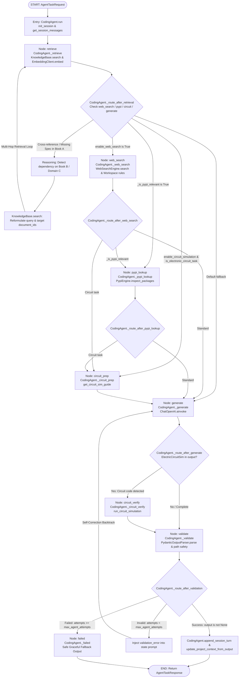
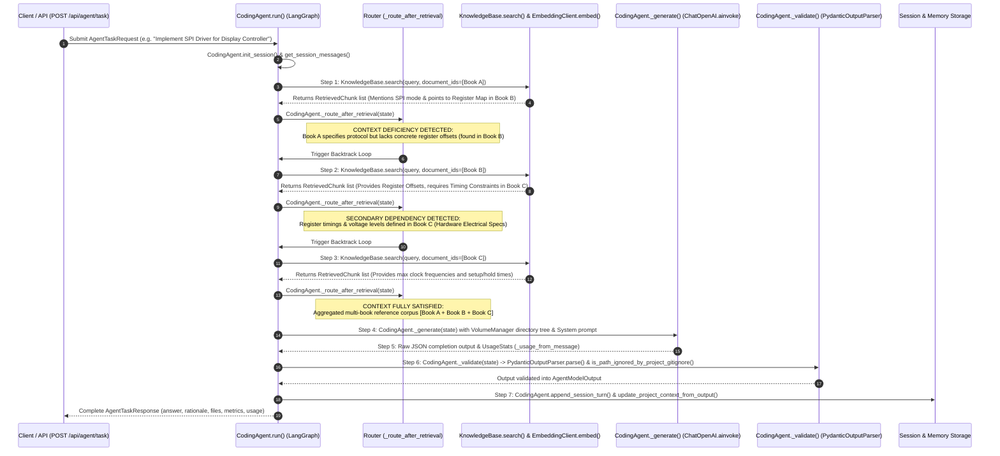

# Chappie 1.0.0b2

Chappie3D runs its FastAPI coding agent on the Windows host. Docker Compose runs the UI, backend, workspace, PostgreSQL and Redis. The model, embedder and Chroma are separate services; publish their ports to the Windows host before starting the agent.

---

## Host startup (Windows PowerShell)

**Existing installation:** before starting the new Compose configuration, follow [the volume export and migration procedure](docs/host-migration.md). An empty bind directory initializes an empty database; do not start the backend against it before restoring and verifying the old data. Never use `docker compose down -v` or remove old named volumes during migration.

From the repository root with Python 3.12, `uv` and Docker Desktop:

```powershell
# New installations only (existing installations: follow docs/host-migration.md first).
New-Item -ItemType Directory -Force -Path '.\service-data\postgres', '.\service-data\redis' | Out-Null
docker compose config --quiet
docker compose up -d --build
uv sync
uv run uvicorn services.agent.main:app --host 0.0.0.0 --port 8003
```

Open `http://localhost:3001`. Nginx routes `/api/` to `backend:8002` and `/ws/terminal` to `host.docker.internal:8003`; the backend routes delegated `/api/*` to the same host agent. Keep the port **8003** fixed unless you also update `ui/nginx.conf` and rebuild the UI. Bind `0.0.0.0` so Docker Desktop containers can reach the Windows host; allow access only from trusted networks in the Windows firewall. The agent still uses the legacy `data/` and `volumes/` paths pending the project-storage migration in step 2; run it from the repository root.

**Standalone terminal clients:** the old Compose-published port **7421** is no longer served. In the terminal client's `server_host`/`server_port` settings, use `localhost` and `8003` to connect directly to the host agent (`ws://localhost:8003/ws/terminal`), or `localhost` and `3001` to connect through Nginx (`ws://localhost:3001/ws/terminal`). For a remote client, use the Windows host name instead of `localhost` and permit the chosen port through the firewall; use `wss://` only when TLS termination is configured. The WebSocket message format and endpoint path are unchanged. The backend default for a backend run on the host is `http://localhost:8003`; Compose overrides it with `http://host.docker.internal:8003`.

Set `.env` host-agent endpoints to `MODEL_BASE_URL=http://localhost:8080/v1`, `CHROMA_HOST=localhost`, `CHROMA_PORT=8000`, `EMBEDDER_URL=http://localhost:8090`, `WORKSPACE_SERVICE_URL=http://localhost:8005` and `REDIS_URL=redis://localhost:6380/0` (or the actual published ports). The model, Chroma and embedder are **not** started by this Compose file; Docker-internal names such as `model`, `chroma`, `embedder` will not resolve on Windows. The `.env` `REDIS_PORT` controls the published port, while the backend always uses `redis:6379` internally. Override `POSTGRES_DATA_PATH` and `REDIS_DATA_PATH` with absolute Windows directories if needed; prepare them explicitly before `compose up` (`create_host_path: false`). The workspace and backend retain their bind mount `./data:/app/data`.

Check connectivity after startup:

```powershell
docker compose ps
Invoke-RestMethod 'http://localhost:8003/api/health'
Invoke-RestMethod 'http://localhost:8004/api/health'
Invoke-RestMethod 'http://localhost:3001/api/health'
Invoke-RestMethod 'http://localhost:3001/api/backend/health'
Test-NetConnection 'localhost' -Port 6380
```

The agent health result may be `degraded` until the separately hosted model/Chroma/embedder become reachable. `/api/health` through the backend verifies the HTTP proxy; `/ws/terminal` is WebSocket-upgraded directly by Nginx with unchanged message format. Verify it with the terminal integration tests after starting the host agent. The model/Chroma/embedder port publishing depends on the separate inference stack.

New projects are ordinary host directories under `PROJECTS_ROOT_PATH` (default `projects`); opening a project uses the exact existing directory path. Agent profiles, registry, permission DB, general contexts, non-project sessions and logs live under `CHAPPIE_DATA_PATH` (default `data`). Configure both as absolute Windows paths for deployment. Existing installations must follow the [non-destructive project cutover plan](docs/project-host-migration.md) before changing these paths; the agent does not silently move old project files or histories.

## Database Persistence & Alembic Migration Logic

PostgreSQL now stores data under the host bind directory `./service-data/postgres` (or `POSTGRES_DATA_PATH`); Redis uses `./service-data/redis` (or `REDIS_DATA_PATH`). These are outside the other containers' shared `./data` mount. See [migration instructions](docs/host-migration.md) before switching an existing installation. No named volumes are declared in Compose.

### Automatic Migration Verification (`init_or_update_migrations`)
On backend startup, `src/chappie/backend/alembic/runner.py` executes the following automatic sync routine:
1. **Connection Verification:** `DatabaseManager.wait_for_db(timeout_seconds=60)` verifies PostgreSQL connectivity via `SELECT 1`.
2. **Revision Inspection:** `get_migration_status()` inspects the database's `alembic_version` table and compares it with migration script heads in `src/chappie/backend/alembic/versions/`.
3. **Smart Synchronization:**
   - **Fresh DB:** Runs `alembic upgrade head` to generate all tables and indices.
   - **Pre-existing Tables (No version record):** Automatically stamps the schema to `head` (`alembic stamp head`).
   - **Outdated Revision:** Upgrades pending migrations up to `head`.
   - **Up-to-Date:** Confirms database head matches migration head and skips unnecessary DDL.
4. **Admin User Auto-Seeding:** `seed_admin_user()` checks if the default admin user exists; if missing, it seeds `username: admin`, `password: admin` (hashed via PBKDF2-HMAC-SHA256), and `is_admin: True`.

---

## Authentication & Session Guard

- **Login Endpoint:** `POST /api/auth/login` validates credentials against PostgreSQL and issues a cryptographically signed HMAC session token.
- **Session Verification:** `GET /api/auth/session` validates the session token, expiration timestamp, and `is_admin` claim.
- **3-Hour Expiry:** Sessions remain valid for 3 hours by default, configured via `SESSION_EXPIRY_HOURS=3` in `.env`.
- **UI Screen Guard:** The Vue frontend checks `/api/auth/session` on initial load. If unauthenticated or non-admin, all application screens are blocked and the user is redirected to the Login view.

---

## Agent Context & Session Memory
Right now before any further actions, any agent reading this file must MICHALS_WAYS.md and comply with its rules.

---

## Agent Reasoning & Multi-Hop Cross-Book Retrieval Flow

Chappie utilizes an iterative, state-driven reasoning engine built on top of **LangGraph** (`CodingAgent._build_graph` in `src/chappie/agent.py`). The agent coordinates semantic search across indexed technical literature, dynamically evaluates context completeness, and executes multi-hop backtracking routines whenever an answer requires cross-referencing information across multiple books, profiles, or domains.

### 1. Agent Reasoning State Graph & Decision Topology



---

### 2. Multi-Hop Cross-Book Backtracking Sequence Diagram

When solving complex engineering tasks (e.g. microcontroller firmware, protocol stacks, or mixed-signal electronics), information in a primary book often references registers, pinouts, or formulas defined in another reference book. The agent iteratively backtracks across books to aggregate all necessary facts before generating code or architecture recommendations:



---

### 3. Detailed Reasoning & Backtracking Steps

1. **Step 1: Session & Profile Resolution (`CodingAgent.run` & `CodingAgent._retrieve`)**
   - Initializes or attaches to active conversation session via `CodingAgent.init_session(session_id)` and retrieves historical turns via `CodingAgent.get_session_messages(session_id)`.
   - Resolves target project context (`project_id` or `volume_name`) using `ProjectStorage.get_project()` or `ProjectStorage.get_project_by_volume()`.
   - Synchronizes root project state via `ProjectStorage.sync_chappie_file()`.
   - Resolves active book collection profile using `ProfileStorage.get_profile()` and checks for electronics domain specialization with `is_electronics_profile()`.
2. **Step 2: Primary Semantic Vector Search (`KnowledgeBase.search` & `EmbeddingClient.embed`)**
   - Generates query dense vector embeddings via `EmbeddingClient.embed([query], kind="query")` against the CUDA Qwen3 Embedder service (`/v1/embeddings`).
   - Executes HNSW cosine search via `KnowledgeBase.search(query, doc_ids, limit=RAG_TOP_K)` against Chroma collection `books_qwen3_06b_v1`.
   - Returns formatted `RetrievedChunk` items mapped to `[Reference: {title}, page {page}]`.
3. **Step 3: Dynamic State Routing (`CodingAgent._route_after_retrieval` & `CodingAgent._is_pypi_relevant`)**
   - Evaluates whether real-time external knowledge is necessary:
     - `enable_web_search` enabled in request or settings -> routes to node `web_search`.
     - `_is_pypi_relevant()` detects pip/PyPI keywords or packages -> routes to node `pypi_lookup`.
     - `is_electronic_circuit_task()` or `is_electronics_profile()` active -> routes to node `circuit_prep`.
     - Otherwise -> proceeds directly to node `generate`.
4. **Step 4: Multi-Tool Context Enrichment & Verification**
   - **Web Search (`CodingAgent._web_search`)**: Queries external sources via `WebSearchEngine.search()`, auditing permissions via `WorkspaceService.get_active_rules()` and recording `WebSearchAuditRecord`.
   - **PyPI Lookup (`CodingAgent._pypi_lookup`)**: Extracts package candidates via `PypiEngine.extract_package_candidates()` and inspects package releases/dependencies via `PypiEngine.inspect_packages()`, recording `PypiAuditRecord`.
   - **Circuit Preparation (`CodingAgent._circuit_prep`)**: Injects SPICE simulation instructions and electronic design guidelines via `get_circuit_sim_guide()` and `get_electronics_agent_prompt_context()`.
   - **Circuit Verification (`CodingAgent._circuit_verify`)**: If `ElectricCircuitSim` is emitted in generated code, executes simulation validation via `run_circuit_simulation(code, timeout, script_path)`.
5. **Step 5: Constrained Generation (`CodingAgent._generate`)**
   - Assembles directory structure context via `VolumeManager.get_directory_tree_summary()` / `get_project_tree_summary()`.
   - Injects Pydantic schema format constraints via `PydanticOutputParser(pydantic_object=AgentModelOutput).get_format_instructions()`.
   - Invokes CUDA LLM via `ChatOpenAI.ainvoke(messages)` and captures execution latency and token metrics via `_usage_from_message()` and `_merge_usage()`.
6. **Step 6: Pydantic Validation & Security Boundary Checks (`CodingAgent._validate`)**
   - Parses LLM output using `PydanticOutputParser.parse(raw_output)` into `AgentModelOutput(answer, rationale, files)`.
   - Enforces strict filesystem sandboxing: resolves each relative path (`pathlib.Path.resolve().relative_to(root)`), rejecting path traversal and drive escapes (`..`, `/`, `C:`).
   - Validates `.gitignore` and security boundary integrity via `VolumeManager.is_path_ignored_by_project_gitignore()`.
7. **Step 7: Self-Correction Retry Loop & Post-Run Finalization (`CodingAgent._route_after_validation`)**
   - If output validation fails, `CodingAgent._route_after_validation` checks `state["attempts"] < settings.max_agent_attempts`. If within limit, it loops back to `generate` with `validation_error` feedback; otherwise it routes to `CodingAgent._failed`.
   - On successful validation, `CodingAgent.run` saves the conversation turn with `CodingAgent.append_session_turn()`, checks memory pressure via `is_memory_spill_required()` and `get_system_memory_usage_pct()`, updates project context via `CodingAgent.update_project_context_from_output()`, and returns the final `AgentTaskResponse`.

---

## Services

- `ui` — Nginx on host port 3001, forwarding API to the backend and terminal WebSockets to the host agent.
- `backend` — container on host port 8004, PostgreSQL authentication and agent HTTP proxy.
- `db` — PostgreSQL 16 on host port 5433; `redis` — cache on host port 6380.
- `workspace` — container on host port 8005.
- `agent` — host process on port 8003. Inference services must be started separately with host-published ports.

## GPU VRAM Acceleration & Indexing Performance

- **GPU VRAM Embedder**: A separately deployed embedder may use NVIDIA CUDA; publish its HTTP port to the Windows host.
- **Configurable Batching & Timeouts**: Fine-tune PDF indexing throughput and timeouts in the host agent `.env`:
  - `INDEXING_BATCH_SIZE=8` (default: 8 chunks per batch on GPU, recommended 4 on CPU)
  - `EMBEDDER_TIMEOUT_SECONDS=300` (default: 300s timeout per batch)
  - `EMBEDDING_DEVICE=cuda` (auto-detects CUDA with CPU fallback)
- **Live & Persistent Logging**: Standalone and container execution logs are multiplexed and saved into timestamped files in `./logs/{project_name}_{prefix}_{YYYYMMDD_HHMMSS}.log`. You can also run `python -m utils.logging` at any time to stream and capture container logs.

## Environment Variables

Chappie and its containerized services are configured via environment variables defined in `.env` or passed through `compose.yaml`.

### 1. Core Model & LLM Inference
| Variable | Type | Default | Description / Constraints |
| :--- | :--- | :--- | :--- |
| `CHAPPIE_VERSION` | `string` | `1.0.0b2` | Semantic version identifier for Chappie. |
| `MODEL_BASE_URL` | `string` | `http://localhost:8080/v1` | Host-published OpenAI-compatible inference URL. |
| `MODEL_NAME` | `string` | `chappie-qwen3-coder` | Target model name passed in LLM completion requests. |
| `MODEL_API_KEY` | `string` | `local-only` | Authorization API key for the inference server. |
| `MODEL_TIMEOUT_SECONDS` | `integer` | `600` | Maximum HTTP request timeout in seconds for LLM generation. |

### 2. Vector Database (ChromaDB)
| Variable | Type | Default | Description / Constraints |
| :--- | :--- | :--- | :--- |
| `CHROMA_HOST` | `string` | `localhost` | Host-published ChromaDB address. |
| `CHROMA_PORT` | `integer` | `8000` | REST API port number for ChromaDB. |
| `CHROMA_COLLECTION` | `string` | `books_qwen3_06b_v1` | Name of the Chroma collection storing document chunk embeddings. |

### 3. Embedding Service & Document Indexing
| Variable | Type | Default | Description / Constraints |
| :--- | :--- | :--- | :--- |
| `EMBEDDER_URL` | `string` | `http://localhost:8090` | Host-published embedding service URL. |
| `EMBEDDER_TIMEOUT_SECONDS` | `integer` | `300` | HTTP timeout in seconds for embedding requests. |
| `INDEXING_BATCH_SIZE` | `integer` | `8` | Number of text chunks embedded per batch during PDF ingestion. |
| `MAX_PDF_MB` | `integer` | `100` | Maximum allowable PDF size in megabytes. |

### 4. RAG Retrieval & Agent Orchestration
| Variable | Type | Default | Description / Constraints |
| :--- | :--- | :--- | :--- |
| `RAG_TOP_K` | `integer` | `8` | Maximum number of relevant book chunks retrieved from Chroma per query. |
| `MAX_AGENT_ATTEMPTS` | `integer` | `2` | Maximum retry attempts for the agent to produce valid structured output. |
| `UI_ORIGINS` | `string` | `http://localhost:3001` | Allowed CORS origin URLs for browser clients (see `.env`). |

### 5. Web Search & PyPI Integration
| Variable | Type | Default | Description / Constraints |
| :--- | :--- | :--- | :--- |
| `ENABLE_WEB_SEARCH` | `boolean` | `false` | Enable Google Custom Search tool integration for the agent. |
| `WEB_SEARCH_MAX_RESULTS` | `integer` | `5` | Maximum number of search results retrieved per web query. |
| `WEB_SEARCH_TIMEOUT_SECONDS` | `integer` | `10` | HTTP timeout in seconds for external web search requests. |
| `ENABLE_PYPI_ACCESS` | `boolean` | `true` | Allow agent to inspect Python package metadata on PyPI. |
| `PYPI_TIMEOUT_SECONDS` | `integer` | `10` | HTTP timeout in seconds for PyPI API requests. |
| `PYPI_BASE_URL` | `string` | `https://pypi.org/pypi` | Base URL for querying PyPI JSON package metadata. |

### 6. Electronics & 3D Simulation
| Variable | Type | Default | Description / Constraints |
| :--- | :--- | :--- | :--- |
| `ENABLE_CIRCUIT_SIMULATION` | `boolean` | `false` | Enable PySpice / NGSpice electronic circuit simulation tools. |
| `CIRCUIT_SIMULATION_TIMEOUT_SECONDS` | `integer` | `15` | Execution timeout in seconds for electronic circuit simulations. |
| `ENABLE_OPENSCAD_EXECUTION` | `boolean` | `false` | Enable OpenSCAD 3D model geometry rendering and validation. |

### 7. Storage Paths & Host Mounts
| Variable | Type | Default | Description / Constraints |
| :--- | :--- | :--- | :--- |
| `POSTGRES_DATA_PATH` | `string` | `./service-data/postgres` | Host bind directory for PostgreSQL, prepared before starting Compose. |
| `REDIS_DATA_PATH` | `string` | `./service-data/redis` | Host bind directory for Redis, prepared before starting Compose. |
| `VOLUMES_BASE_PATH` | `string` | `volumes` | Legacy host project volume path pending project migration. |
| `PROJECTS_FILE_PATH` | `string` | `data/projects.json` | Legacy host project metadata file pending project migration. |
| `PROFILES_FILE_PATH` | `string` | `data/profiles.json` | Host profile file. |

### 8. Security & Backup
| Variable | Type | Default | Description / Constraints |
| :--- | :--- | :--- | :--- |
| `CHROMA_BACKUP_PASSWORD` | `string` | `""` | Symmetric passphrase for password-encrypted ChromaDB backup archives. |

### 9. Logging & Diagnostics
| Variable | Type | Default | Description / Constraints |
| :--- | :--- | :--- | :--- |
| `CHAPPIE_LOG_DIR` | `string` | `./logs` | Host directory where multiplexed container execution logs are saved. |

### 10. Workspace Microservice (Optional)
| Variable | Type | Default | Description / Constraints |
| :--- | :--- | :--- | :--- |
| `WORKSPACE_ENABLED` | `boolean` | `true` | Enable integration with the Workspace service. |
| `WORKSPACE_SERVICE_URL` | `string` | `http://localhost:8005` | Host-published workspace URL used by the agent. |
| `WORKSPACE_DATABASE_URL` | `string` | `sqlite:////app/data/workspace.db` | Workspace container SQLite database on the `./data` bind mount. |
| `WORKSPACE_SERVICE_HOST` | `string` | `0.0.0.0` | Host bind address for the workspace microservice daemon. |
| `WORKSPACE_SERVICE_PORT` | `integer` | `8001` | Port number for the workspace microservice REST API. |

## Index a book

Use the PDF upload panel in the UI. The host agent reads project files under the legacy `volumes/` path until the project storage migration; there is no Compose indexer service.

## Development

\`\`\`powershell
uv sync --group dev
uv run pytest
uv run uvicorn services.agent.main:app --host 0.0.0.0 --port 8003 --reload
\`\`\`

Frontend:

\`\`\`powershell
Set-Location ui
npm install
npm run dev
\`\`\`

Both the package and product use the version \`1.0.0b2\`.
